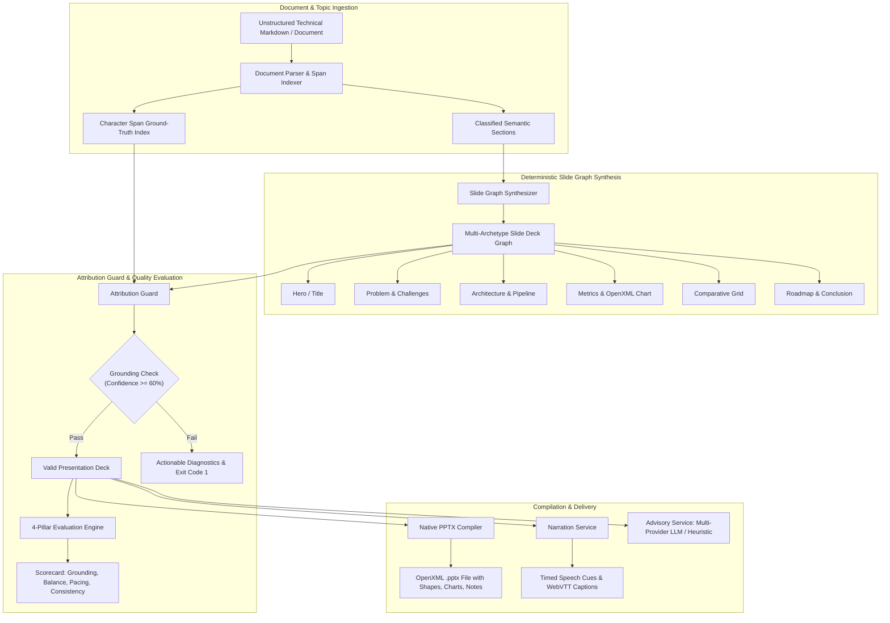

# atlas-hub-ryan-vo — Ryan Vo | AI & Machine Learning

Current version: `1.0.0`.

Atlas Hub solves the problem of hallucinated, fragile, and uneditable presentation decks in AI generation pipelines. While generative models can draft slide copy, production presentation authoring workflows require verifiable factual attribution, predictable layout geometry, native client-side PowerPoint editability (.pptx), and actionable integrity diagnostics. Atlas Hub implements a deterministic document ingestion engine, a multi-archetype slide graph synthesizer, an OpenXML presentation compiler, and a fail-closed Attribution Guard with span-level grounding verification designed for ML engineers, enterprise analysts, and developer tool platforms.



---

## AI/ML Evaluation

Atlas Hub evaluates generated presentation decks against indexed source document spans using reproducible factual containment metrics, visual balance heuristics, narrative pacing variance, and terminology consistency checks.

### Reproducible Evaluation Command

To run the automated evaluation suite across the domain test corpus:

```bash
# In the virtual environment with PYTHONPATH=backend
PYTHONPATH=backend .venv/bin/python -m pytest backend/tests/test_attribution_guard.py backend/tests/test_evaluation_engine.py -v
```


### Data Provenance & Test Corpus

The evaluation operates on the structured test corpus and presentation documents within this repository, with ground-truth character spans and quantitative metric assertions documented in the test files.

### Evaluation

Atlas Hub evaluates generated presentation decks against indexed source document spans using reproducible factual containment metrics, visual balance heuristics, narrative pacing variance, and terminology consistency checks. The evaluation suite is exercised via the backend test suite:

```bash
PYTHONPATH=backend .venv/bin/python -m pytest backend/tests/test_attribution_guard.py backend/tests/test_evaluation_engine.py -v
```

The 4-pillar quality scorecard (Grounding, Balance, Pacing, Consistency) provides measurable quality assessment for each synthesized presentation.

---
## Features

- **Hierarchical Document Ingestion**: Parses Markdown headers, bullet points, quantitative assertions, and builds byte/character span indices for ground-truth tracking.
- **Deterministic Slide Graph Synthesis**: Synthesizes 6 distinct slide archetypes:
  - `hero_title`: Title banner, scope overview, and metadata.
  - `problem_solution`: Split-view layout contrasting challenges against engineering solutions.
  - `architecture_process`: Step-by-step pipeline flow with takeaway cards.
  - `metrics_chart`: Primary metric scorecard alongside native OpenXML category column charts.
  - `comparison_grid`: Multi-column comparative feature matrix.
  - `conclusion_roadmap`: Executive summary and strategic next milestones.
- **Native OpenXML PowerPoint Compiler**: Generates editable `.pptx` files with real shapes, text frames, native tables, native charts, transition triggers, and embedded presenter notes.
- **Attribution Guard**: A fail-closed integrity gate that maps each presentation assertion back to source text spans. Emits structured diagnostics (`ATTR_UNGROUNDED_CLAIM`, `ATTR_METRIC_MISMATCH`, `ATTR_LANG_MIXED`) and explicit exit codes rather than silent failures.
- **4-Pillar Quality Scorecard**: Computes overall quality from Grounding (40%), Balance (25%), Pacing (20%), and Terminology Consistency (15%).
- **Audio Narration Studio**: Calculates syllable counts, words per minute (WPM), speech duration, pause markers, and exports time-synchronized WebVTT captions (`.vtt`).
- **Provider-Agnostic LLM Advisory**: Opt-in advisory analysis supporting OpenAI-compatible, Anthropic, Gemini, and Ollama with an offline rule-based heuristic core.
- **Enterprise OIDC & Keycloak Broker Authentication**: Secure authorization-code login with PKCE, in-memory SPA token storage, role-based access control (`viewer`, `analyst`, `admin`), and SAML broker configuration.

---

## Architecture & Workflows

### Workflow 1: Document Ingestion & Slide Graph Synthesis
Users input technical specifications, research documents, or topic briefs. The backend parser extracts semantic chunks and generates a structured slide graph. The PPTX compiler builds a native `.pptx` file directly downloadable from the browser.

### Workflow 2: Attribution Guard & Quality Evaluation
The platform runs span-level containment verification. If an assertion cannot be traced to the source text, the Attribution Guard emits structured diagnostic items with actionable remediation guidance and sets exit code 1.

### Workflow 3: Multi-Template Adaptation & Narration Planning
Decks are mapped to responsive design templates (`modern-navy`, `emerald-clean`, `slate-minimal`) and canvas aspect ratios (16:9 or 4:3). The narration planner compiles speaker notes into timestamped speech cues and WebVTT caption files.

---

## API Reference

| Method | Endpoint | Description | Roles |
| :--- | :--- | :--- | :--- |
| `POST` | `/api/auth/demo-login` | Issue local JWT bearer token in development mode | Public (Dev only) |
| `POST` | `/api/auth/callback` | Exchange PKCE authorization code with Keycloak | Public |
| `GET` | `/api/auth/me` | Fetch authenticated user principal and assigned roles | All |
| `POST` | `/api/auth/logout` | Invalidate user session | All |
| `POST` | `/api/presentations` | Ingest document and synthesize slide graph | `analyst`, `admin` |
| `GET` | `/api/presentations` | List presentations with pagination and filtering | All |
| `GET` | `/api/presentations/{id}` | Retrieve presentation detail and full slide nodes | All |
| `PUT` | `/api/presentations/{id}` | Update presentation title, template, or aspect ratio | `analyst`, `admin` |
| `DELETE` | `/api/presentations/{id}` | Delete presentation and associated slides | `analyst`, `admin` |
| `GET` | `/api/presentations/{id}/export/pptx` | Export presentation as native OpenXML `.pptx` file | All |
| `POST` | `/api/presentations/{id}/evaluate` | Execute Attribution Guard and 4-pillar scorecard | `analyst`, `admin` |
| `GET` | `/api/presentations/{id}/evaluation` | Retrieve latest quality evaluation scorecard | All |
| `POST` | `/api/presentations/{id}/narration` | Generate audio pacing schedule and narration cues | `analyst`, `admin` |
| `GET` | `/api/presentations/{id}/narration` | Retrieve narration plan | All |
| `GET` | `/api/presentations/{id}/narration/vtt` | Export time-synchronized WebVTT captions | All |
| `GET` | `/api/templates` | List supported design themes and aspect ratios | All |
| `POST` | `/api/presentations/{id}/advisory` | Request grounded presentation advisory review | `analyst`, `admin` |
| `GET` | `/api/health` | Service health status | Public |

---

## Installation & Local Development

### Prerequisites
- Python 3.12+
- Node.js 24+
- Docker & Docker Compose (optional for full-stack Keycloak stack)

### 1. Backend Setup

```bash
# Create virtual environment and install dependencies
python3 -m venv .venv
source .venv/bin/activate
pip install -r backend/requirements.txt

# Run backend test suite
PYTHONPATH=backend pytest backend/tests -v

# Start development server
uvicorn app.main:app --host 127.0.0.1 --port 8000 --reload
```

### 2. Frontend Setup

```bash
cd frontend
npm ci
npm run build
npm test

# Start frontend development server
npm run dev
```

The frontend will bind to `http://127.0.0.1:3000` with API requests proxied to `http://127.0.0.1:8000`.

---

## Docker & Compose Deployment

Atlas Hub includes container definitions and a Compose setup with Keycloak:

```bash
# Start Keycloak, backend, and frontend containers bound to 127.0.0.1
docker compose up -d

# Verify health status
curl http://127.0.0.1:8000/api/health
```

### TLS Reverse Proxy Requirements
In production deployments:
1. Terminate TLS at a fronting reverse proxy (e.g. Caddy, NGINX, or Envoy).
2. Set `X-Forwarded-Proto: https` and `X-Forwarded-For` headers.
3. Configure `APP_ENV=production` and supply `OIDC_ISSUER` and `OIDC_DISCOVERY_URL`.
4. Ensure `DEMO_MODE=false`. Startup refuses execution if demo mode is enabled in production.

---

## Authentication & SSO Setup

Atlas Hub implements standard OIDC Authorization Code Flow with PKCE (S256).

### Keycloak Realm Configuration
- Realm import file: `docker/keycloak/realm-export.json`.
- Client ID: `atlas-hub-app` (public client, PKCE required).
- Roles: `viewer`, `analyst`, `admin`.

### Upstream SAML IdP Identity Brokering
Keycloak handles enterprise SAML IdPs (Okta, Azure AD / Entra ID, PingIdentity) through identity brokering:
1. Navigate to Keycloak Admin Console (`http://127.0.0.1:8080/admin`).
2. Go to **Identity Providers** &rarr; **Add provider** &rarr; **SAML 2.0**.
3. Import your enterprise IdP metadata XML or provide the Single Sign-On URL and signing certificate.
4. Set NameID policy to Email Address.
5. In Mappers, map IdP SAML attributes (e.g., `memberOf` or `roles`) to realm roles `analyst` or `viewer`.
6. Users logging in through SAML are brokered transparently into OIDC JWT tokens validated by Atlas Hub.

---

## Provider Configuration Table

| Variable | Secret | Description | Default |
| :--- | :--- | :--- | :--- |
| `LLM_API_KEY` | **Yes** | Server-side API key for optional LLM advisory | *(None / Offline heuristic core active)* |
| `LLM_PROVIDER` | No | Provider adapter (`openai-compatible`, `anthropic`, `gemini`, `ollama`) | `openai-compatible` |
| `LLM_MODEL` | No | Target model identifier | `gpt-4o-mini` |
| `LLM_BASE_URL` | No | Operator-configured endpoint base URL | *(Provider default endpoint)* |

*Advisory is strictly opt-in. The offline heuristic core runs deterministically without an LLM key.*

---

## Security Limitations

- **Local Demo Isolation**: Demo token generation is restricted strictly to development mode and refused at startup in production.
- **In-Memory Token Lifecycle**: Access tokens are maintained in memory within the React context and never stored in `localStorage`. PKCE code verifiers are cleared after token exchange.
- **Credential Redaction**: External provider error messages are filtered through regex redaction patterns to prevent key leakage in application logs.
- **Fail-Closed Integrity**: The Attribution Guard terminates with exit code 1 whenever factual containment or required title attributes cannot be established.

---

## License

MIT License &bull; Copyright (c) 2026 Ryan Vo &lt;ryandtvo@gmail.com&gt;
